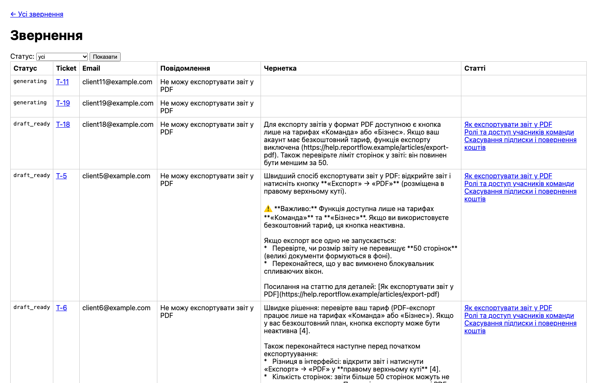
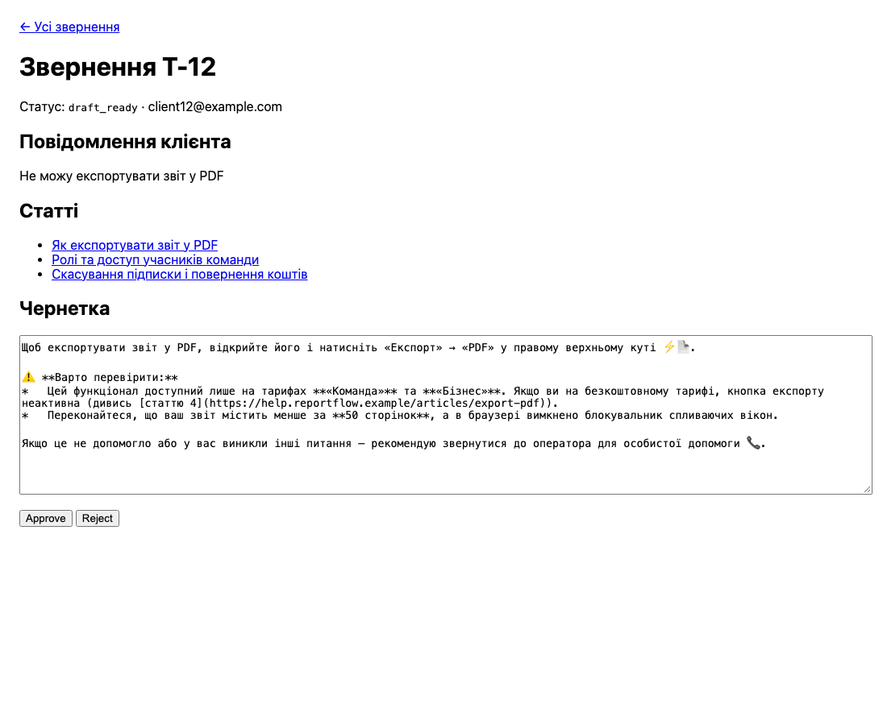
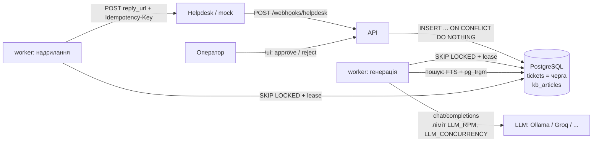
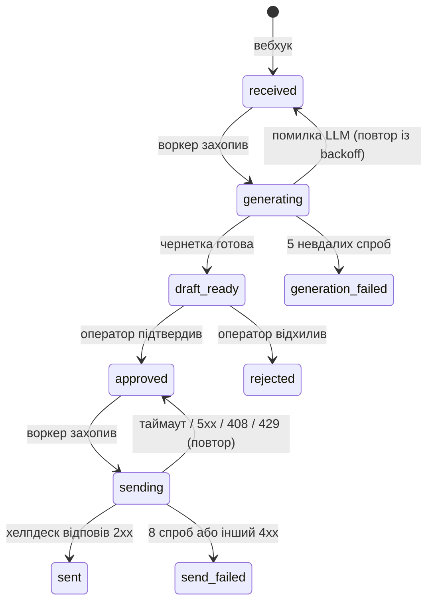
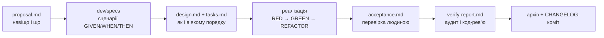

# Support Draft Service

**Сервіс, який перетворює звернення в підтримку на готові чернетки відповідей: LLM пише текст на основі бази знань, оператор підтверджує, клієнт отримує відповідь рівно один раз.**


> **TL;DR (EN).** Async FastAPI service: a helpdesk webhook stores tickets idempotently (p99 = 134 ms under 600 concurrent requests), a background worker drafts replies with any OpenAI-compatible LLM using a PostgreSQL full-text knowledge base, an operator approves drafts in a server-rendered UI, and approved replies are delivered with retries and an `Idempotency-Key`. The queue is a PostgreSQL table (`FOR UPDATE SKIP LOCKED` + leases) — no Redis or Celery. Built stage by stage with Claude Code under a spec → test → acceptance workflow.

## Зміст

- [Що робить сервіс](#що-робить-сервіс)
- [Ключові результати](#ключові-результати)
- [Демо](#демо)
- [Архітектура](#архітектура)
- [Як закрито вимоги ТЗ](#як-закрито-вимоги-тз)
- [Швидкий старт](#швидкий-старт)
- [Налаштування LLM](#налаштування-llm)
- [Змінні оточення](#змінні-оточення)
- [Тести](#тести)
- [Навантажувальний прогін](#навантажувальний-прогін)
- [Рішення і компроміси](#рішення-і-компроміси)
- [Структура репозиторію](#структура-репозиторію)
- [AI-first процес розробки](#ai-first-процес-розробки)
- [Деплой](#деплой)
- [Що далі](#що-далі)

## Що робить сервіс

1. **Отримання.** Хелпдеск шле звернення на `POST /webhooks/helpdesk`; сервіс зберігає його і за мілісекунди відповідає `202`, навіть якщо та сама подія прийшла кілька разів одночасно.
2. **Генерація.** Фоновий воркер знаходить до трьох релевантних статей бази знань і просить LLM написати коротку чернетку мовою клієнта з посиланнями на ці статті.
3. **Модерація.** Оператор у веб-інтерфейсі `/ui` бачить звернення з чернетками, за потреби правит текст і натискає **Approve** або **Reject**.
4. **Надсилання.** Підтверджена відповідь іде клієнту через `POST <reply_url>` хелпдеску з повторами при збоях і одним `Idempotency-Key` на всі спроби.

Сервіс працює з будь-яким OpenAI-сумісним LLM (локальна Ollama, Groq, Gemini, OpenRouter) і навіть **без API-ключа** — тоді чернетка статична, але весь конвеєр проходить так само.

## Ключові результати

| | |
|---|---|
| ⚡ **Швидкий вебхук** | p99 = **134 мс** на 600 запитах із паралельністю 50 (вимога — < 2 с) |
| 🔁 **Нуль дублів на вході** | 500 унікальних подій + 100 дублів (частина — одночасних) → рівно 500 рядків |
| 📬 **Нуль дублів на виході** | при 30% відповідей `500` і 30% таймаутів хелпдеску всі 10 відповідей доставлено, 0 повторних ключів у хелпдеску |
| 🧵 **Жодної втраченої задачі** | черга з lease: задача впалого воркера повертається в обробку; SIGTERM дочікується генерацій або повертає їх у чергу |
| 🚦 **Ліміти LLM** | ковзне вікно `LLM_RPM`/60 с + семафор `LLM_CONCURRENCY` на весь воркер |
| ✅ **Покриття** | 147 тестів, кожен із 58 сценаріїв специфікацій має end-to-end тест або ручну перевірку |

## Демо

Список звернень із чернетками, статтями й фільтром за статусом (автооновлення раз на 10 с):



Картка звернення: оператор правит чернетку і підтверджує або відхиляє її:



## Архітектура



Життєвий цикл звернення:



| Сервіс `docker compose` | Що робить |
|---|---|
| `db` | PostgreSQL 16 з healthcheck; порт відкритий лише на `127.0.0.1` |
| `migrate` | одноразово: `alembic upgrade head` + сід бази знань із `kb/articles/*.md` |
| `api` | FastAPI: вебхук, `/health`, UI оператора, мок хелпдеску `/mock/helpdesk/...` |
| `worker` | `python -m app.worker`: два асинхронні цикли — генерація і надсилання |

## Як закрито вимоги ТЗ

| Обмеження | Рішення | Де перевірено |
|---|---|---|
| Вебхук відповідає ≤ 2 с, інакше повтор | вебхук лише пише в БД і одразу повертає `202`, жодного LLM у запиті | тест без вихідних з'єднань; навантаження p99 = 134 мс |
| Та сама подія приходить кілька разів, зокрема одночасно | `UNIQUE(event_id)` + `INSERT ... ON CONFLICT DO NOTHING` | тест: 10 одночасних запитів → 1 рядок; навантаження: 600 → 500 |
| Пік 500 звернень / 10 хв, не можна втрачати | черга — таблиця PostgreSQL, захоплення `FOR UPDATE SKIP LOCKED` з lease | тести одночасних захоплень і протермінованого lease |
| LLM 5–30 с, ліміт 60 RPM | асинхронний воркер, лімітер `LLM_RPM` + семафор `LLM_CONCURRENCY` | тести ковзного вікна й паралельності |
| Хелпдеск дає 5xx / таймаут, клієнт не має отримати відповідь двічі | стейт-машина `approved → sending → sent`, повтори з backoff і jitter, один `Idempotency-Key` | тести «2×5xx, потім 201» і «таймаут, але прийнято»; живий прогін із нестабільним моком |
| Працювати без API-ключа | реальний запит до провайдера все одно робиться, відповідь — статична чернетка після затримки | тести режиму без ключа; ручна перевірка на стеку |

## Швидкий старт

Потрібні Docker і [uv](https://docs.astral.sh/uv/) (для тестів і скриптів).

```bash
git clone https://github.com/Senndin/support-draft-service.git && cd support-draft-service
cp .env.example .env
docker compose up --build
```

| Адреса | Що там |
|---|---|
| http://localhost:8000/health | перевірка живості |
| http://localhost:8000/ui | інтерфейс оператора |
| http://localhost:8000/mock/helpdesk/replies | відповіді, які «отримав» хелпдеск |

Надіслати кілька звернень (частина — дублі) і подивитися, як вони проходять конвеєр:

```bash
uv run python -m scripts.send_webhooks --count 10 --dup-rate 0.2 --concurrency 5
```

Немає LLM під рукою — залиште `LLM_API_KEY=` порожнім у `.env`.

## Налаштування LLM

Один клієнт під OpenAI-сумісний API (`POST {LLM_BASE_URL}/chat/completions`); провайдер змінюється лише змінними оточення.

### Ollama локально (macOS)

Docker Desktop на macOS не має доступу до GPU, тому Ollama працює нативно на хості, а контейнери ходять до неї через `host.docker.internal`.

```bash
ollama pull qwen3.5:4b
launchctl setenv OLLAMA_NUM_PARALLEL 4 && launchctl setenv OLLAMA_KEEP_ALIVE 30m   # і перезапустити Ollama
```

```env
LLM_BASE_URL=http://host.docker.internal:11434/v1
LLM_API_KEY=ollama
LLM_MODEL=qwen3.5:4b
LLM_REASONING_EFFORT=none
LLM_CONCURRENCY=2
```

> **Моделі з міркуванням.** `qwen3.5:4b` за замовчуванням генерує тисячі токенів «роздумів» і не вкладається в таймаут; `LLM_REASONING_EFFORT=none` передається як `reasoning_effort` і скорочує відповідь до кількох секунд. Цю проблему знайшла ручна приймальна перевірка — див. [AI-first процес](#ai-first-процес-розробки).

Якщо з контейнера `connection refused` — `launchctl setenv OLLAMA_HOST 0.0.0.0` і перезапуск Ollama.

### Хмарний провайдер

| Провайдер | `LLM_BASE_URL` | Модель (приклад) | Примітка |
|---|---|---|---|
| Groq | `https://api.groq.com/openai/v1` | `llama-3.3-70b-versatile` | free-ліміт ~30 RPM → `LLM_RPM=30` |
| Google Gemini | `https://generativelanguage.googleapis.com/v1beta/openai/` | `gemini-2.5-flash` | free tier — Flash-моделі |
| OpenRouter | `https://openrouter.ai/api/v1` | моделі з `:free` | жорсткі денні ліміти |

`LLM_RPM` ставиться за фактичним лімітом ключа (не вище 60). При 30 с на виклик пік 50 звернень/хв потребує ~25 паралельних запитів → `LLM_CONCURRENCY=25`.

### Режим без ключа

Якщо `LLM_API_KEY` порожній, сервіс усе одно робить реальний запит до `LLM_BASE_URL` (без `Authorization`, через ті самі ліміти) і логує статус, але відповідь ігнорує: після затримки `STUB_DELAY_MIN_S..STUB_DELAY_MAX_S` повертається статична чернетка з назвами й посиланнями знайдених статей. Далі вона проходить той самий шлях, що й справжня.

## Змінні оточення

| Змінна | За замовчуванням | Призначення |
|---|---|---|
| `DATABASE_URL` | `postgresql+asyncpg://postgres:postgres@db:5432/support` | підключення до БД |
| `LLM_BASE_URL` | `http://host.docker.internal:11434/v1` | OpenAI-сумісний API |
| `LLM_API_KEY` | порожньо | ключ; порожньо — режим без ключа |
| `LLM_MODEL` | `qwen2.5:7b-instruct` | модель |
| `LLM_TIMEOUT_S` | `60` | таймаут виклику LLM |
| `LLM_REASONING_EFFORT` | порожньо | `reasoning_effort` для моделей з міркуванням (`none` вимикає) |
| `LLM_RPM` | `60` | ліміт викликів LLM за 60 с на процес воркера |
| `LLM_CONCURRENCY` | `4` | одночасних викликів LLM |
| `STUB_DELAY_MIN_S` / `STUB_DELAY_MAX_S` | `5` / `30` | затримка статичної чернетки (для тестів — `0`) |
| `OPERATOR_PASSWORD` | порожньо | пароль Basic Auth для `/ui`; порожньо — без автентифікації |
| `HELPDESK_TIMEOUT_S` | `10` | таймаут надсилання відповіді в хелпдеск |
| `MOCK_FAIL_RATE` / `MOCK_SLOW_RATE` | `0` / `0` | частка `500` і «повільних» відповідей мока хелпдеску |

## Тести

```bash
docker compose up -d db
uv run pytest
```

- **147 тестів**: юніт-тести модулів і end-to-end тести кожного сценарію специфікацій (`tests/test_functional_*.py`).
- Тести працюють з окремою БД `support_test` (перевизначається `TEST_DATABASE_URL`), яку фікстура сама створює й мігрує через Alembic; без PostgreSQL DB-тести пропускаються з підказкою.
- Збої зовнішніх систем (таймаут LLM, 5xx і «повільний» хелпдеск) відтворюються через `httpx.MockTransport` і справжній мок хелпдеску.
- Сценарії, що потребують Docker або людини (підйом стеку, справжня Ollama, браузер), записані й пройдені в `dev/changes/archive/*/acceptance.md`.

## Навантажувальний прогін

```bash
uv run python -m scripts.send_webhooks --count 500 --dup-rate 0.2 --concurrency 50
```

MacBook M3 Pro, стек у Docker, режим без ключа, чиста таблиця `tickets`:

| Метрика | Значення |
|---|---|
| Надіслано запитів | 600 (500 унікальних подій + 100 дублів) |
| Відповіді | `202: 600`, помилок 0 |
| Затримка вебхука | p50 = 54 мс, **p99 = 134 мс**, max = 144 мс |
| Рядків у `tickets` | 500, `count(distinct event_id)` = 500 |

Генерація розбирає чергу незалежно від вебхука, і її швидкість обмежує провайдер LLM та `LLM_RPM`. З локальною Ollama на ноутбуці — близько 7 чернеток/хв: черга росте, але нічого не губиться.

## Рішення і компроміси

- **Черга в PostgreSQL замість брокера.** ~1 подія/с у піку для Postgres дрібниця, а транзакційність і durability — «з коробки». Захоплення — `UPDATE ... WHERE id IN (SELECT ... FOR UPDATE SKIP LOCKED) RETURNING *` з lease.
- **Ідемпотентність на рівні БД, а не коду.** Унікальний індекс серіалізує одночасні дублі; варіант «SELECT, потім INSERT» має гонку.
- **Атомарна модерація.** `UPDATE ... WHERE status='draft_ready'`: подвійний клік чи дві вкладки дають одне рішення, друге — `409`.
- **Exactly-once — чесно.** Один `Idempotency-Key` на всі спроби дає exactly-once, лише якщо хелпдеск поважає ключ (мок поважає). Без цього — at-least-once з мінімізацією дублів: таймаут після фактичного прийому призведе до повтору.
- **Ліміт LLM in-process.** Для одного воркера достатньо; при кількох репліках сумарний RPM множиться — тоді лічильник має переїхати в PostgreSQL.
- **Пошук — PostgreSQL FTS** (`simple` + префікси слів як грубий стемінг для української) з fallback на `pg_trgm` для опечаток. Для 8–10 статей ембеддинги й pgvector — оверкіл.
- **Мок хелпдеску в тому ж застосунку**, з пам'яттю процесу `api`: один сервіс простіше запускати й деплоїти; дедуплікація мока не спільна між репліками.

Повний журнал рішень за етапами — [`docs/decisions.md`](docs/decisions.md).

## Структура репозиторію

```text
app/
  main.py                FastAPI: підключення роутерів
  config.py              налаштування з оточення (pydantic-settings)
  models.py              Ticket (звернення + черга), KbArticle
  api/                   /health, /webhooks/helpdesk
  services/              kb.py (пошук), llm.py (клієнт + режим без ключа),
                         ratelimit.py, helpdesk.py (надсилання)
  worker/                цикли генерації й надсилання, спільний run_queue
  ui/                    інтерфейс оператора (Jinja2)
  mock_helpdesk/         мок хелпдеску
kb/articles/             8 статей бази знань (Markdown + front-matter)
migrations/              Alembic
scripts/                 seed_kb.py, send_webhooks.py (імітатор хелпдеску / навантаження)
tests/                   юніт- і end-to-end тести
dev/specs/               специфікації поведінки (14 доменів, 58 сценаріїв)
dev/changes/archive/     історія етапів: proposal, design, tasks, acceptance, verify-report
docs/                    ROADMAP.md, decisions.md, скриншоти
```

## AI-first процес розробки

Проєкт зроблено з Claude Code за [`docs/ROADMAP.md`](docs/ROADMAP.md) у 7 етапів, кожен — повний цикл spec-test-driven процесу DevSkills:



- **Специфікації — контракт.** Кожна вимога має сценарії, кожен сценарій — end-to-end тест або ручну перевірку; верифікація звіряє код зі специфікаціями й робить код-рев'ю.
- **Тест перед кодом.** Кожна задача починалась із тесту, що падає з правильної причини.
- **Приймання людиною ловить те, чого не бачать тести.** На етапі 4 ручна перевірка зі справжньою Ollama показала, що модель з міркуванням не вкладається в таймаут; діагноз → регресійний тест → виправлення (`LLM_REASONING_EFFORT`, порожня відповідь LLM — помилка) → повторний прогін.
- **Рішення не губляться.** Неоднозначності фіксувались у `notes.md` кожної зміни й у [`docs/decisions.md`](docs/decisions.md), а не в голові.
- **Історія «як є».** 60+ комітів у стилі Conventional Commits, без squash; кожен етап — своя гілка з архівом артефактів у [`dev/changes/archive/`](dev/changes/archive).

Інструкції для агента — [`AGENTS.md`](AGENTS.md) / [`CLAUDE.md`](CLAUDE.md).

## Деплой

Цільова платформа — **Oracle Cloud Always Free**: повноцінна ВМ, де стек запускається тим самим `docker compose`, а воркер працює постійно (PaaS-тарифи без оплати не дають фонових процесів або присипляють сервіс, що ламає вимогу «вебхук ≤ 2 с»).

1. Створити інстанс Always Free (Ampere A1, Ubuntu 24.04 — образи `python:3.14-slim` і `postgres:16` мультиархітектурні, ARM підходить).
2. Відкрити порт: у VCN → Security List додати Ingress TCP `8000` (або `80/443` для reverse proxy); в Ubuntu-образах Oracle також `sudo iptables -I INPUT -p tcp --dport 8000 -j ACCEPT && sudo netfilter-persistent save`.
3. Встановити Docker: `curl -fsSL https://get.docker.com | sh && sudo usermod -aG docker $USER` (перелогінитись).
4. Розгорнути:

```bash
git clone https://github.com/Senndin/support-draft-service.git && cd support-draft-service
cp .env.example .env
# у .env: LLM_BASE_URL / LLM_API_KEY / LLM_MODEL хмарного провайдера (Groq або Gemini),
#         LLM_RPM за лімітом ключа, LLM_REASONING_EFFORT= (порожньо), OPERATOR_PASSWORD=<сильний пароль>
docker compose up -d --build
```

- PostgreSQL назовні не відкритий (`127.0.0.1`), назовні — лише порт `8000`; для HTTPS — reverse proxy (Caddy / nginx).
- Хелпдеск налаштовується на `https://<домен>/webhooks/helpdesk`, оператор працює на `https://<домен>/ui` з паролем `OPERATOR_PASSWORD`.

## Що далі

- Ліміт LLM і метрики черги (довжина, вік найстаршої задачі) у PostgreSQL для кількох воркерів.
- Повторне надсилання `send_failed` і перегенерація `generation_failed` з UI; пагінація списку.
- Очищення `last_error` після успіху, обмеження довжини полів вебхука, зрозуміліша помилка сіду.
- Ембеддинги для пошуку, коли статей стане сотні; триграмний індекс — уже на десятках.
- Перевірка підпису вебхука й CSRF-токени у формах UI.
