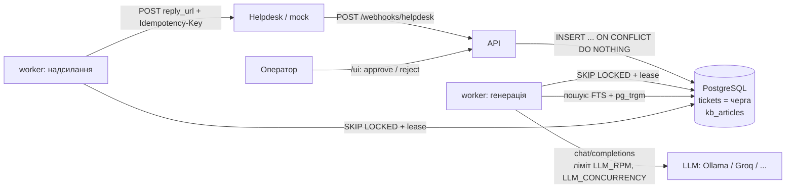
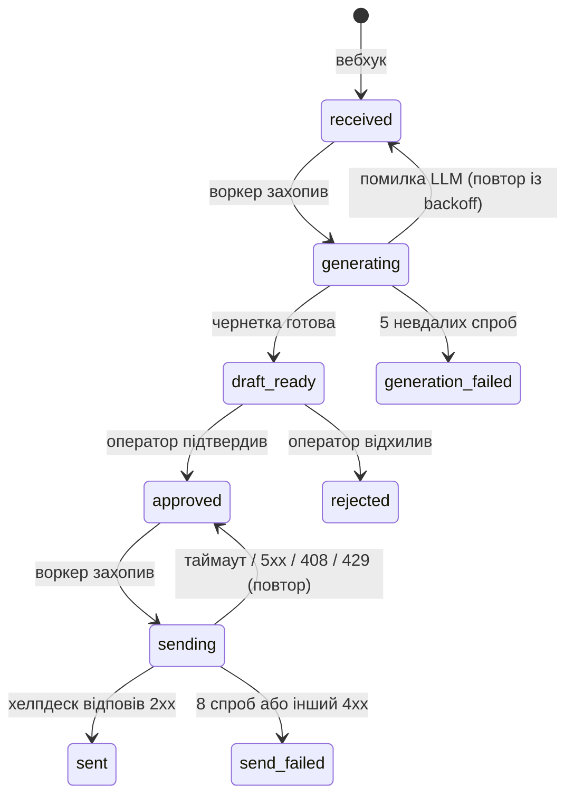

# Support Draft Service

Сервіс обробляє звернення в підтримку і готує для оператора чернетку відповіді за допомогою LLM:

1. **Отримання** — хелпдеск шле звернення на `POST /webhooks/helpdesk`.
2. **Генерація** — воркер шукає релевантні статті бази знань і просить LLM написати чернетку з посиланнями на них.
3. **Модерація** — оператор у веб-UI (`/ui`) бачить звернення з чернетками, виправляє текст і підтверджує або відхиляє.
4. **Надсилання** — підтверджена відповідь іде клієнту через `POST <reply_url>` хелпдеску з `Idempotency-Key`.

Плюс `GET /health` → `200 {"status": "ok"}`.

Стек: Python 3.14, FastAPI, SQLAlchemy 2.0 (async) + asyncpg, Alembic, PostgreSQL 16, Jinja2, httpx, pytest. Без Redis/Celery: черга — таблиця в PostgreSQL.

## Архітектура



Статуси звернення:



Сервіси `docker-compose.yml`:

| Сервіс | Що робить |
|---|---|
| `db` | PostgreSQL 16 з healthcheck; порт відкритий лише на `127.0.0.1` (для тестів) |
| `migrate` | одноразово: `alembic upgrade head` + сід бази знань із `kb/articles/*.md` |
| `api` | FastAPI: вебхук, `/health`, UI оператора, мок хелпдеску (`/mock/helpdesk/...`) |
| `worker` | `python -m app.worker`: два асинхронні цикли — генерація і надсилання |

## Швидкий старт

```bash
cp .env.example .env
docker compose up --build
```

- `http://localhost:8000/health` — перевірка живості;
- `http://localhost:8000/ui` — інтерфейс оператора;
- `http://localhost:8000/mock/helpdesk/replies` — відповіді, які «отримав» хелпдеск.

Надіслати кілька звернень (частина — дублі):

```bash
uv run python -m scripts.send_webhooks --count 10 --dup-rate 0.2 --concurrency 5
```

Без LLM сервіс теж працює: залиште `LLM_API_KEY=` порожнім (див. нижче).

## Налаштування LLM

Один клієнт під OpenAI-сумісний API (`POST {LLM_BASE_URL}/chat/completions`); провайдер змінюється лише змінними оточення.

### Ollama локально (macOS)

Docker Desktop на macOS не має доступу до GPU, тому Ollama запускається нативно на хості, а контейнери ходять до неї через `host.docker.internal`.

```bash
ollama pull qwen3.5:4b          # або інша модель з хорошою українською
launchctl setenv OLLAMA_NUM_PARALLEL 4 && launchctl setenv OLLAMA_KEEP_ALIVE 30m   # і перезапустити Ollama
```

```env
LLM_BASE_URL=http://host.docker.internal:11434/v1
LLM_API_KEY=ollama
LLM_MODEL=qwen3.5:4b
LLM_REASONING_EFFORT=none     # для моделей з міркуванням (qwen3.5 тощо) — інакше вони не вкладаються в таймаут
LLM_CONCURRENCY=2
```

`LLM_REASONING_EFFORT` передається як `reasoning_effort`: `qwen3.5:4b` без нього генерує тисячі токенів міркувань (хвилини), з `none` — відповідає за кілька секунд. Якщо `connection refused` з контейнера — `launchctl setenv OLLAMA_HOST 0.0.0.0` і перезапуск Ollama.

### Хмарний провайдер (для деплою)

| Провайдер | `LLM_BASE_URL` | Модель (приклад) | Примітка |
|---|---|---|---|
| Groq | `https://api.groq.com/openai/v1` | `llama-3.3-70b-versatile` | free-ліміт ~30 RPM → `LLM_RPM=30` |
| Google Gemini | `https://generativelanguage.googleapis.com/v1beta/openai/` | `gemini-2.5-flash` | free tier — Flash-моделі |
| OpenRouter | `https://openrouter.ai/api/v1` | моделі з `:free` | жорсткі денні ліміти |

`LLM_RPM` — за фактичним лімітом ключа, не вище 60; `LLM_CONCURRENCY=25` вистачає, щоб при 30 с на виклик тримати пік 50 звернень/хв.

### Режим без ключа

Якщо `LLM_API_KEY` порожній, сервіс усе одно робить реальний запит до `LLM_BASE_URL` (без `Authorization`, через ті самі ліміти) і логує його статус, але результат ігнорує: після затримки `STUB_DELAY_MIN_S..STUB_DELAY_MAX_S` повертається статична чернетка з назвами й посиланнями знайдених статей. Далі вона проходить той самий шлях, що й справжня.

## Змінні оточення

| Змінна | За замовчуванням | Призначення |
|---|---|---|
| `DATABASE_URL` | `postgresql+asyncpg://postgres:postgres@db:5432/support` | підключення до БД |
| `LLM_BASE_URL` | `http://host.docker.internal:11434/v1` | OpenAI-сумісний API |
| `LLM_API_KEY` | порожньо | ключ; порожньо — режим без ключа |
| `LLM_MODEL` | `qwen2.5:7b-instruct` | модель |
| `LLM_TIMEOUT_S` | `60` | таймаут виклику LLM |
| `LLM_REASONING_EFFORT` | порожньо | `reasoning_effort` для моделей з міркуванням (`none` вимикає) |
| `LLM_RPM` | `60` | ліміт викликів LLM за 60 с на процес воркера |
| `LLM_CONCURRENCY` | `4` | одночасних викликів LLM |
| `STUB_DELAY_MIN_S` / `STUB_DELAY_MAX_S` | `5` / `30` | затримка статичної чернетки (для тестів — `0`) |
| `OPERATOR_PASSWORD` | порожньо | пароль Basic Auth для `/ui`; порожньо — без автентифікації |
| `HELPDESK_TIMEOUT_S` | `10` | таймаут надсилання відповіді в хелпдеск |
| `MOCK_FAIL_RATE` / `MOCK_SLOW_RATE` | `0` / `0` | частка `500` і «повільних» відповідей мока хелпдеску |

## Тести

```bash
docker compose up -d db
uv run pytest
```

Тести працюють з окремою БД `support_test` на `localhost:${DB_PORT:-5432}` (перевизначається `TEST_DATABASE_URL`), яку фікстура сама створює й мігрує; без PostgreSQL DB-тести пропускаються з підказкою. Сценарії специфікацій (`dev/specs/`) покриті end-to-end тестами; ті, що потребують Docker або людини (підйом стеку, справжня Ollama, браузер), — у `dev/changes/archive/*/acceptance.md`.

## Навантажувальний прогін

```bash
uv run python -m scripts.send_webhooks --count 500 --dup-rate 0.2 --concurrency 50
```

Результат на MacBook M3 Pro (стек у Docker, режим без ключа, `STUB_DELAY_*=0`, чиста таблиця `tickets`):

| Метрика | Значення |
|---|---|
| Надіслано запитів | 600 (500 унікальних подій + 100 дублів) |
| Відповіді | `202: 600`, помилок 0 |
| Затримка вебхука | p50 = 54 мс, **p99 = 134 мс**, max = 144 мс (вимога — < 2 с) |
| Рядків у `tickets` | 500, `count(distinct event_id)` = 500 — усі події збережені, дублів немає |

Генерація розбирає чергу незалежно від вебхука: швидкість обмежена провайдером LLM і `LLM_RPM`. З локальною Ollama на ноутбуці — близько 7 чернеток/хв; черга росте, але нічого не губиться (звернення лежать у `received` і забираються воркером по мірі можливості).

## Ключові рішення і компроміси

- **Вебхук лише пише в БД** (`INSERT ... ON CONFLICT (event_id) DO NOTHING`) і одразу відповідає `202` — жодного LLM у запиті; дублі, зокрема одночасні, відсікає унікальний індекс.
- **Черга — таблиця `tickets` у PostgreSQL**: захоплення `SELECT ... FOR UPDATE SKIP LOCKED` з lease (`locked_until`), тож задача впалого воркера повертається в обробку; транзакційність «з коробки», без брокерів.
- **Модерація атомарна**: `UPDATE ... WHERE status='draft_ready'`; подвійний клік чи дві вкладки дають одне рішення, друге — `409`.
- **Надсилання без дублів**: один `Idempotency-Key` на звернення для всіх спроб, повтори з експоненційним backoff і jitter. **Чесне обмеження:** exactly-once можливий, лише якщо хелпдеск поважає ключ ідемпотентності; без цього — at-least-once з мінімізацією дублів (таймаут після фактичного прийому дасть повтор).
- **Ліміт LLM in-process** (ковзне вікно 60 с + семафор): достатньо для одного воркера; при кількох репліках сумарний RPM множиться — тоді лічильник має жити в PostgreSQL.
- **Пошук — PostgreSQL FTS** (`simple` + префікси слів як грубий стемінг) з fallback на `pg_trgm` для опечаток; для 8–10 статей ембеддинги/pgvector — оверкіл.
- **Мок хелпдеску в тому ж застосунку** і з пам'яттю процесу `api`: простіше запускати й деплоїти; дедуплікація мока не спільна між репліками.

Усі рішення з поясненнями — у [`docs/decisions.md`](docs/decisions.md); специфікації — у [`dev/specs/`](dev/specs).

## Деплой на VPS

Будь-який VPS з Docker:

```bash
git clone <repo> support-draft && cd support-draft
cp .env.example .env
# у .env: LLM_BASE_URL / LLM_API_KEY / LLM_MODEL хмарного провайдера (Groq або Gemini),
#         LLM_RPM за лімітом ключа, LLM_REASONING_EFFORT= (порожньо), OPERATOR_PASSWORD=<сильний пароль>
docker compose up -d --build
```

- PostgreSQL назовні не відкритий (`127.0.0.1`), назовні — лише порт `8000` (`api`); для HTTPS поставте перед ним reverse proxy (Caddy / nginx).
- Хелпдеск налаштовується на `https://<домен>/webhooks/helpdesk`; оператор працює на `https://<домен>/ui` з паролем `OPERATOR_PASSWORD`.
- Публічні посилання: _додати після деплою._

## Що далі

- Ліміт LLM і лічильник спроб у PostgreSQL для кількох воркерів; метрики черги (довжина, вік найстаршої задачі).
- Очищати `last_error` після успішної генерації/надсилання; обмежити довжину полів вебхука; зрозуміліша помилка сіду для файлу без front-matter.
- Повторне надсилання `send_failed` і перегенерація `generation_failed` з UI; пагінація списку.
- Ембеддинги для пошуку, коли статей стане сотні; триграмний індекс уже на десятках.
- Перевірка підпису вебхука і CSRF-токени у формах UI.

## Як влаштована розробка

Проєкт зроблено по етапах [`docs/ROADMAP.md`](docs/ROADMAP.md) за spec-test-driven процесом DevSkills: кожен етап — зміна в `dev/changes/` (proposal → специфікації → design → tasks → реалізація з тестами → приймання → верифікація → архів). Архів змін — `dev/changes/archive/`, інструкції для агента — `AGENTS.md` / `CLAUDE.md`.
