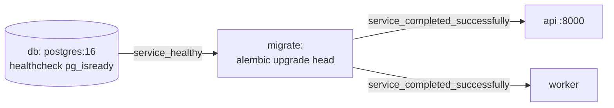

# stage-1-skeleton

## Контекст

<!-- Context -->

Репозиторій зараз містить лише агентну конфігурацію (`dev/`, `.claude/`, `AGENTS.md`) і `docs/ROADMAP.md`; коду застосунку немає.
Стек зафіксований у ROADMAP: Python 3.14, FastAPI, SQLAlchemy 2.0 async + asyncpg, Alembic, PostgreSQL 16, `pytest` + `pytest-asyncio`, запуск через `docker compose up`.
Ця зміна будує каркас під вимоги [`health-check`](/dev/specs/health-check/spec.md) і [`service-runtime`](/dev/specs/service-runtime/spec.md); бізнес-логіки (тікети, KB, LLM) у ній немає.

## Мета

**Цілі:**
<!-- Goals -->

- `docker compose up` на чистій машині піднімає `db`, `migrate`, `api`, `worker`; `curl localhost:8000/health` → `200`.
- `uv run pytest` проходить локально без запущеної БД.
- Структура каталогів відповідає розділу 5 ROADMAP, щоб наступні етапи лише додавали файли.

**Поза межами зміни:**
<!-- Non-Goals -->

- Моделі `Ticket` і `KbArticle`, сід бази знань, вебхук, UI, мок хелпдеску — етапи 2–6.
- Цикли генерації й надсилання у воркері — етапи 4 і 6.
- Деплой і README — етап 7.

## Рішення

<!-- Decisions -->

**Залежності — `uv`.**
`pyproject.toml` + `uv.lock`; у `Dockerfile` бінарник `uv` копіюється з офіційного образу `ghcr.io/astral-sh/uv`, далі `uv sync --frozen --no-dev`.
Альтернатива `pip` + `requirements.txt` відкинута: ROADMAP вимагає один спосіб, а `uv` уже використовує тулінг DevSkills.

**Один образ, три ролі.**
Базовий образ `python:3.14-slim`; той самий образ запускається як `api` (`uvicorn app.main:app --host 0.0.0.0 --port 8000`), `worker` (`python -m app.worker`) і `migrate` (`alembic upgrade head`).
Окремі образи на кожну роль — зайва складність без виграшу.

**Порядок старту через `depends_on`.**

Альтернатива — міграції в entrypoint `api` — відкинута: тоді `worker` міг би стартувати раніше за схему, а при кількох репліках `api` міграції запускалися б паралельно.
На етапі 3 у той самий сервіс `migrate` додасться сід бази знань.
`api` і `worker` мають `extra_hosts: host.docker.internal:host-gateway` для доступу до Ollama на хості (розділ 3.1 ROADMAP).

**Конфігурація — один клас `Settings` (pydantic-settings).**
`app/config.py` експортує `Settings` і модульний екземпляр `settings`.
Поля: `database_url` (дефолт `postgresql+asyncpg://postgres:postgres@db:5432/support`), `llm_base_url`, `llm_api_key` (дефолт порожній), `llm_model`, `llm_timeout_s`, `llm_rpm` (60), `llm_concurrency` (4), `stub_delay_min_s` (5), `stub_delay_max_s` (30).
LLM-поля оголошуються вже зараз, щоб `.env.example` був повним з першого етапу; читає їх код етапу 4.
`.env` підхоплюється через `env_file` у `docker-compose.yml`, а не через `model_config`, щоб у тестах на налаштування не впливав локальний файл.

**БД — `app/db.py`.**
`engine = create_async_engine(settings.database_url)` і `SessionLocal = async_sessionmaker(engine, expire_on_commit=False)`.
`app/models.py` містить лише `class Base(DeclarativeBase)`; моделі додаються на етапах 2–3.
Engine створюється ліниво при першому запиті (так працює SQLAlchemy), тож `/health` і тести без БД не потребують.

**Alembic — async-шаблон.**
`alembic init -t async migrations`; `migrations/env.py` бере URL із `settings.database_url` і `target_metadata = Base.metadata`.
Перша ревізія порожня (`upgrade`/`downgrade` — `pass`); повторний `upgrade head` ідемпотентний штатно, бо Alembic веде `alembic_version`.

**`/health` не ходить у БД.**
Спека вимагає незалежності від зовнішніх викликів; перевірку готовності БД виконує healthcheck `db` у compose.
Роутер `app/api/health.py`, підключення в `app/main.py`.

**Воркер-заглушка.**
`app/worker/__main__.py`: `asyncio.run(main())`, де `main` ставить обробники SIGTERM/SIGINT через `loop.add_signal_handler`, які встановлюють `asyncio.Event`, логує старт і чекає на подію.
Цикли генерації/надсилання на етапах 4 і 6 запускатимуться всередині того ж `main` і зупинятимуться тією ж подією.

**Тести.**
`pytest` + `pytest-asyncio` (`asyncio_mode = "auto"` у `pyproject.toml`); `/health` тестується через `httpx.AsyncClient(transport=ASGITransport(app))` без мережі й БД.
Сценарії `service-runtime` про compose і повторні міграції потребують Docker — вони йдуть у `acceptance.md`, а не в `pytest`.

**Агентна документація.**
Плейсхолдери кореневого `AGENTS.md` заповнюються (назва, стек, команди, тести, міграції, стиль комітів без co-authorship trailer); `CLAUDE.md` лишається `@AGENTS.md` і отримує посилання на `docs/ROADMAP.md`.
Рішення етапу коротко фіксуються в `docs/decisions.md` за правилом ROADMAP.

## Вплив

<!-- Impact -->

- Нові файли: `pyproject.toml`, `uv.lock`, `Dockerfile`, `.dockerignore`, `docker-compose.yml`, `.env.example`, `.gitignore`, `alembic.ini`, `migrations/` (з першою ревізією), `app/{__init__,main,config,db,models}.py`, `app/api/{__init__,health}.py`, `app/worker/{__init__,__main__}.py`, `tests/test_health.py`, `tests/test_config.py`, `docs/decisions.md`.
- Змінені файли: `AGENTS.md`, `CLAUDE.md`.
- Нові залежності: `fastapi`, `uvicorn[standard]`, `sqlalchemy[asyncio]`, `asyncpg`, `alembic`, `pydantic-settings`, `httpx`; dev — `pytest`, `pytest-asyncio`.
- Порт хоста `8000` (api); Postgres назовні не публікується.

## Ризики та компроміси

<!-- Risks and Trade-offs -->

- Частина залежностей (`asyncpg`, `uvloop`) може не мати колес під Python 3.14 і збиратися з вихідників: ставимо `uvicorn[standard]` лише якщо `uv sync` у `python:3.14-slim` проходить, інакше — голий `uvicorn`; рішення фіксується в `docs/decisions.md`.
- `/health` не перевіряє БД, тож «живий» `api` при недоступній БД усе одно відповідає `200`: це відповідає спеці (живість, а не готовність); перевірку готовності можна додати окремим ендпоінтом, коли знадобиться.
- `docs/ROADMAP.md` лежить не в корені, як показано в розділі 5 ROADMAP: посилання в `CLAUDE.md` ведуть на фактичне місце, файл не переноситься.
