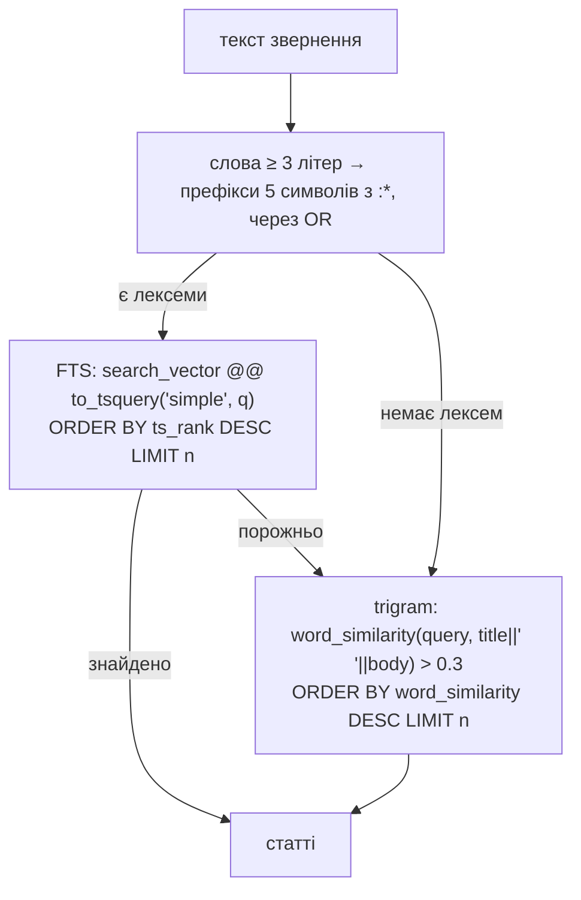

# stage-3-kb-search

## Контекст

<!-- Context -->

Після етапу 2 у БД є таблиця `tickets`, тестова інфраструктура з БД `support_test` і сервіс `migrate` у compose.
Ця зміна реалізує [`kb-seed`](/dev/specs/kb-seed/spec.md) і [`kb-search`](/dev/specs/kb-search/spec.md).
ROADMAP фіксує: PostgreSQL FTS (`to_tsvector('simple', ...)`, `ts_rank`) з fallback на `pg_trgm`, топ-3, без ембеддингів.

## Мета

**Цілі:**
<!-- Goals -->

- Запит «Не можу експортувати звіт у PDF» повертає `export-pdf` першою.
- Сід ідемпотентний і запускається разом зі стеком.
- `app/services/kb.py: search(session, query, limit=3) -> list[KbArticle]` готовий для воркера етапу 4.

**Поза межами зміни:**
<!-- Non-Goals -->

- Ембеддинги, pgvector — шлях розвитку для README (етап 7).
- Видалення статей, файлів яких більше немає, — сід лише вставляє й оновлює.
- HTTP-ендпоінт пошуку: пошук викликає лише воркер.

## Рішення

<!-- Decisions -->

**Модель `KbArticle`.**
Колонки: `id` (int PK), `slug` (text, UNIQUE), `title`, `body`, `url` (text, NOT NULL), `search_vector` — generated stored `tsvector`: `to_tsvector('simple', title || ' ' || body)`, GIN-індекс `ix_kb_articles_search_vector`.
У моделі колонка оголошена через `Computed(..., persisted=True)`, тож SQLAlchemy не пише в неї.

**Міграція `create_kb_articles`** поверх `3021c65eeb7b`: `CREATE EXTENSION IF NOT EXISTS pg_trgm`, таблиця, GIN-індекс; `downgrade` видаляє індекс, таблицю й розширення.

**Пошук — два кроки в `app/services/kb.py`.**

`to_query(text) -> str`: `re.findall(r"\w+", text.lower())`, відкидаються слова коротші за 3 символи, кожне обрізається до 5 символів і отримує `:*`, результат — через ` | `.
Обрізання до 5 символів — грубий стемінг для української: «експортувати», «експорт», «експорту» дають спільний префікс `експо`.
Слова з символами поза `\w` у запит не потрапляють, тож ін'єкція в синтаксис `tsquery` неможлива; значення передається параметром.
Поріг `word_similarity` 0.3 — дефолт `pg_trgm`.

**Сід — `scripts/seed_kb.py`.**
`load_articles(directory) -> list[dict]`: читає `*.md`, розбирає front-matter між першими двома рядками `---` як пари `key: value`; відсутнє поле → `ValueError("<файл>: немає поля <поле>")`.
`seed(session, articles) -> None`: `insert(KbArticle).values(...).on_conflict_do_update(index_elements=["slug"], set_={title, body, url})`.
`main()`: `asyncio.run` з `SessionLocal`, каталог `kb/articles` відносно кореня репозиторію.
PyYAML не додається: front-matter — плоскі рядки `key: value`.

**Запуск при старті стеку.**
`migrate` у compose: `command: ["sh", "-c", "alembic upgrade head && python -m scripts.seed_kb"]`.

**Тести.**
Фікстура `kb` у `tests/conftest.py`: `TRUNCATE kb_articles`, сід статей із `kb/articles` у тестову БД, повертає фабрику сесій.

## Вплив

<!-- Impact -->

- Нові файли: `kb/articles/*.md` (8 статей), `app/services/__init__.py`, `app/services/kb.py`, `scripts/seed_kb.py`, `migrations/versions/<rev>_create_kb_articles.py`, `tests/test_kb.py`, `tests/test_seed_kb.py`, `tests/test_functional_kb.py`.
- Змінені файли: `app/models.py` (`KbArticle`), `docker-compose.yml` (команда `migrate`), `tests/conftest.py` (фікстура `kb`), `AGENTS.md` (тестові дані), `docs/decisions.md`.
- Нові залежності: немає; розширення PostgreSQL `pg_trgm`.

## Ризики та компроміси

<!-- Risks and Trade-offs -->

- Префікс із 5 символів дає хибні збіги між різними словами зі спільним початком: на 8 статтях ранжування `ts_rank` це перекриває; при великій базі — український словник `hunspell` або ембеддинги.
- Короткі слова (до 3 символів, напр. «PDF» має 3 — проходить; «у», «не» — ні) відкидаються; абревіатури з 2 літер не шукаються — прийнятно для запитів клієнтів.
- Без триграмного індексу fallback сканує таблицю: для 8 статей це мікросекунди; індекс `gin_trgm_ops` додати, коли статей стане сотні.
