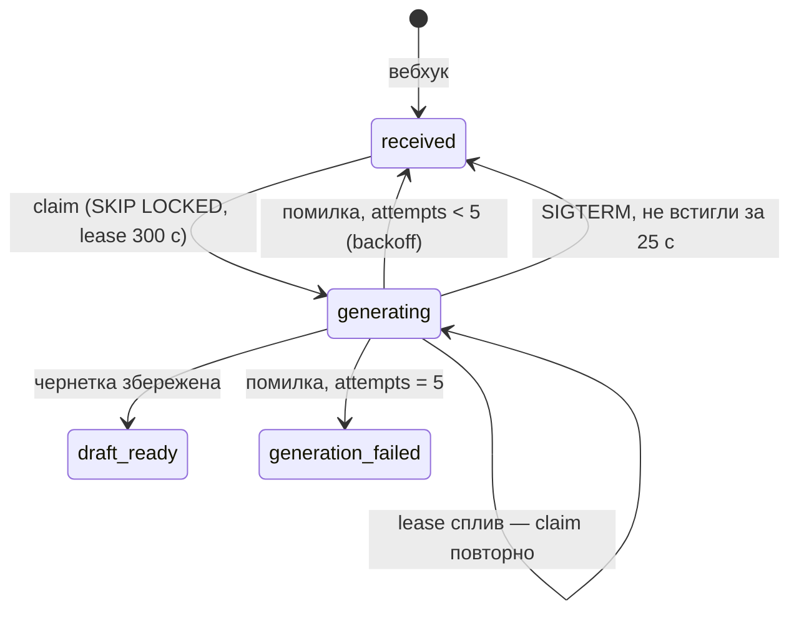

# stage-4-llm-worker

## Контекст

<!-- Context -->

Після етапів 2–3 у БД є `tickets` (з колонками черги `attempts`, `next_attempt_at`, `locked_until`, `last_error`) і база знань з `app/services/kb.search`.
Воркер (`python -m app.worker`) поки лише чекає SIGTERM.
Ця зміна реалізує [`llm-draft`](/dev/specs/llm-draft/spec.md), [`llm-rate-limit`](/dev/specs/llm-rate-limit/spec.md), [`draft-generation`](/dev/specs/draft-generation/spec.md) і доповнює [`service-runtime`](/dev/specs/service-runtime/spec.md).
ROADMAP фіксує: один клієнт під OpenAI-сумісний API на `httpx`, одна функція `generate_draft` з двома гілками без ієрархії класів, in-process limiter + семафор, черга — `SKIP LOCKED` з lease.

## Мета

**Цілі:**
<!-- Goals -->

- Звернення проходить `received → generating → draft_ready` без участі людини.
- Жодне звернення не губиться: ні при помилці LLM, ні при падінні воркера, ні при SIGTERM.
- Ліміт `LLM_RPM` і `LLM_CONCURRENCY` не перевищується за жодного навантаження.

**Поза межами зміни:**
<!-- Non-Goals -->

- Кілька процесів воркера і ліміт у Postgres — trade-off для README (етап 7).
- Стрімінг відповіді LLM, перевірка якості чернетки.
- Цикл надсилання — етап 6.

## Рішення

<!-- Decisions -->

**`app/services/ratelimit.py` — ковзне вікно.**
`RateLimiter(rate: int, period: float)` з `async acquire()`: `deque` моментів останніх викликів під `asyncio.Lock`; якщо у вікні вже `rate` викликів — `asyncio.sleep` до звільнення найстарішого.
Лок утримується під час сну, тож черга очікувачів строго FIFO і не «штурмує» вікно.
Альтернатива token bucket дає сплески до `rate` на межі вікон, а ковзне вікно гарантує саме те, що каже спека.

**`app/services/llm.py` — одна функція з двома гілками.**
`DraftResult(text: str, article_ids: list[int])` — dataclass; `LLMError(Exception)`.
`async generate_draft(message: str, articles: list[KbArticle], client: httpx.AsyncClient) -> DraftResult`.
Обидві гілки викликають `_call_provider(client, payload, api_key)`, який бере `limiter.acquire()` і `semaphore` (модульні, ліниво з `settings.llm_rpm` / `settings.llm_concurrency`) і робить `POST {LLM_BASE_URL}/chat/completions` з таймаутом `LLM_TIMEOUT_S`.
З ключем: `Authorization: Bearer`, помилки (`httpx.HTTPError`, не 2xx, немає `choices[0].message.content`) → `LLMError` з описом.
Без ключа: запит без `Authorization`, статус або помилка лише логуються, далі `asyncio.sleep(random.uniform(STUB_DELAY_MIN_S, STUB_DELAY_MAX_S))` і статична чернетка з шаблону.
Клієнт `httpx` передається параметром: воркер тримає один на весь процес, тести підставляють `httpx.MockTransport`.

**Промпт (розділ 3.4 ROADMAP).**
System: агент підтримки ReportFlow; відповідати мовою клієнта, коротко, лише на основі статей; обов'язково посилання на використані статті; якщо статті не покривають питання — чесно сказати й запропонувати оператора.
User: `Звернення клієнта:\n{message}\n\nСтатті бази знань:\n[{id}] {title} — {url}\n{body}` для кожної статті (або «Статей не знайдено.»).

**`app/worker/generation.py` — черга і цикл.**

- `claim(session, limit) -> list[Ticket]`: один `UPDATE tickets SET status='generating', locked_until=now()+300 s, updated_at=now() WHERE id IN (SELECT id ... WHERE (status='received' AND next_attempt_at <= now()) OR (status='generating' AND locked_until < now()) ORDER BY id LIMIT :limit FOR UPDATE SKIP LOCKED) RETURNING *`.
- `process(factory, ticket, client)`: пошук у KB → `generate_draft` → `UPDATE ... SET status='draft_ready', draft, article_ids, locked_until=NULL WHERE id=:id AND status='generating'`; при будь-якому винятку — `fail(...)`: `attempts+1`, `last_error`, і або `received` з `next_attempt_at = now() + 10·2^(attempts−1) с`, або `generation_failed`.
- `release(factory, ids)`: `UPDATE ... SET status='received', locked_until=NULL WHERE id IN :ids AND status='generating'`.
- `run(factory, client, stop: asyncio.Event)`: поки не `stop` — захопити `LLM_CONCURRENCY − running` задач, запустити кожну як `asyncio.Task`; якщо нічого не захоплено — чекати `stop` до 1 с. Після `stop`: `asyncio.wait(running, timeout=25)`, незавершені скасувати й `release`.
- Константи модуля: `LEASE_S = 300`, `MAX_ATTEMPTS = 5`, `BACKOFF_BASE_S = 10`, `POLL_S = 1`, `SHUTDOWN_GRACE_S = 25` (менше за `stop_grace_period: 30s` у compose).

**`app/worker/__main__.py`.**
`main()` створює `httpx.AsyncClient` і запускає `generation.run(SessionLocal, client, stop)`; сигнали ставлять ту саму подію `stop`.

## Вплив

<!-- Impact -->

- Нові файли: `app/services/ratelimit.py`, `app/services/llm.py`, `app/worker/generation.py`, `tests/test_ratelimit.py`, `tests/test_llm.py`, `tests/test_generation.py`, `tests/test_functional_generation.py`.
- Змінені файли: `app/worker/__main__.py`, `tests/test_worker.py` (воркер тепер звертається до БД), `AGENTS.md`, `docs/decisions.md`.
- Нові залежності: немає (`httpx` уже є).
- БД: схема не змінюється.

## Ризики та компроміси

<!-- Risks and Trade-offs -->

- Лімітер in-process: при кількох репліках воркера сумарний RPM множиться — фіксується в README як trade-off; шлях — лічильник у Postgres.
- Lease 300 с: якщо генерація реально триває довше (лімітер + таймаут), задачу може захопити повторно ще живий воркер — фінальний `UPDATE ... WHERE status='generating'` не дасть записати результат двічі, але LLM буде викликано двічі; 300 с з великим запасом перекриває найгірший випадок 60 + 60 + 30 с.
- Помилка в `fail()` (БД недоступна) залишає задачу в `generating` до кінця lease — потім її захопить наступний цикл, тож вона не губиться.
- Якщо LLM відповідає мовою, відмінною від мови клієнта, або без посилань — це якість моделі, перевіряється вручну в `acceptance.md`.
