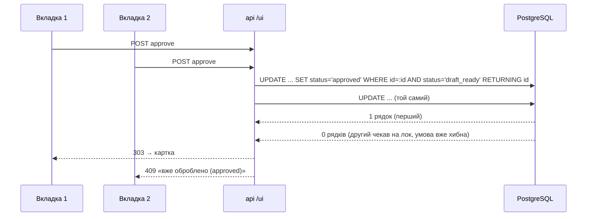

# stage-5-operator-ui

## Контекст

<!-- Context -->

Після етапу 4 звернення доходять до `draft_ready` з `draft` і `article_ids`; колонки `final_message` та `idempotency_key` уже є в `tickets`.
Ця зміна реалізує [`operator-ui`](/dev/specs/operator-ui/spec.md), [`moderation`](/dev/specs/moderation/spec.md) і [`operator-auth`](/dev/specs/operator-auth/spec.md).
ROADMAP фіксує: Jinja2-шаблони, звичайні HTML-форми, без JS-фреймворків; атомарний `UPDATE ... WHERE id=:id AND status='draft_ready'`.

## Мета

**Цілі:**
<!-- Goals -->

- Повний цикл у браузері: список → картка → Approve/Reject.
- Подвійний клік і дві вкладки не дають двох рішень.
- Публічний деплой можна закрити одним `OPERATOR_PASSWORD`.

**Поза межами зміни:**
<!-- Non-Goals -->

- Дизайн, JS, пагінація, пошук по тексту.
- Ролі й облікові записи операторів.
- Надсилання відповіді клієнту — етап 6 (approve лише готує `final_message` і `idempotency_key`).

## Рішення

<!-- Decisions -->

**Роутер `app/ui/routes.py`, шаблони в `app/ui/templates/`.**
`APIRouter(prefix="/ui", dependencies=[Depends(require_operator)])` — Basic Auth підключається на рівні роутера, тож `/health` і `/webhooks/helpdesk` його не мають.
`Jinja2Templates(directory=<шлях до templates>)`; шаблони: `base.html` (каркас, мінімальний inline-CSS), `list.html`, `ticket.html`, `conflict.html`.

| Маршрут | Відповідь |
|---|---|
| `GET /ui?status=` | `200`, таблиця до 200 звернень (`ORDER BY id DESC`), форма фільтра, `meta refresh 10` |
| `GET /ui/tickets/{id}` | `200` картка / `404` |
| `POST /ui/tickets/{id}/approve` (форма `final_message`) | `303` → картка / `409` / `404` / `422` |
| `POST /ui/tickets/{id}/reject` | `303` → картка / `409` / `404` |

**Статті** для сторінки довантажуються одним запитом `SELECT ... FROM kb_articles WHERE id = ANY(:ids)` за всіма `article_ids` сторінки; у шаблон іде `dict[id, KbArticle]`.

**Атомарне рішення.**

`decide(session, ticket_id, values) -> str | None`: `UPDATE tickets SET ..., updated_at=now() WHERE id=:id AND status='draft_ready' RETURNING id`; якщо рядок повернувся — успіх, інакше читається поточний статус: немає звернення → `404`, інакше `409` з `conflict.html`.
Approve: `status='approved'`, `final_message=<обрізаний текст>`, `idempotency_key=uuid4()`; reject: `status='rejected'`.
Порожній `final_message` → `HTTPException(422)` до звернення до БД.

**Basic Auth — `require_operator`.**
`HTTPBasic(auto_error=False)`; якщо `settings.operator_password` порожній — пропуск; інакше `secrets.compare_digest` пароля, при невдачі `HTTPException(401, headers={"WWW-Authenticate": "Basic"})`.
`Settings` отримує `operator_password: str = ""`, `.env.example` — `OPERATOR_PASSWORD=`.

**Сесія** — та сама залежність `get_session`, тож тести перевизначають її, як для вебхука.

## Вплив

<!-- Impact -->

- Нові файли: `app/ui/__init__.py`, `app/ui/routes.py`, `app/ui/templates/{base,list,ticket,conflict}.html`, `tests/test_ui.py`, `tests/test_moderation.py`, `tests/test_operator_auth.py`, `tests/test_functional_ui.py`.
- Змінені файли: `app/main.py` (роутер), `app/config.py` і `.env.example` (`OPERATOR_PASSWORD`), `pyproject.toml`/`uv.lock` (`jinja2`, `python-multipart`), `AGENTS.md`, `docs/decisions.md`.
- БД: схема не змінюється.

## Ризики та компроміси

<!-- Risks and Trade-offs -->

- Без CSRF-захисту форм: інтерфейс внутрішній, за Basic Auth; при розширенні — токен у формі.
- Список обмежено 200 рядками без пагінації: фільтр за статусом дозволяє дістатися потрібних; пагінацію додати, коли звернень стане тисячі.
- `meta refresh` перезавантажує сторінку списку, а не картку — на картці текст, який редагує оператор, не втрачається.
