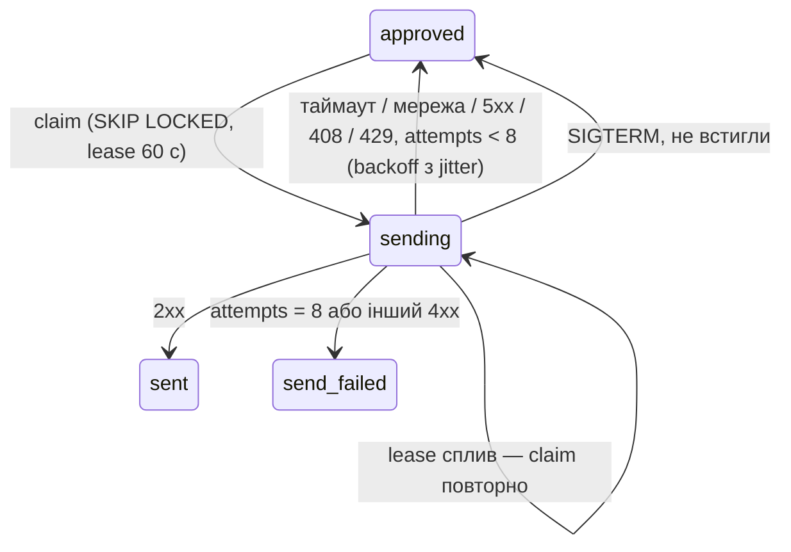

# stage-6-reply-sending

## Контекст

<!-- Context -->

Після етапу 5 оператор переводить звернення в `approved`, зберігаючи `final_message` і `idempotency_key`.
Воркер має цикл генерації (`app/worker/generation.py`) з чергою на `SKIP LOCKED`, lease і штатною зупинкою.
Ця зміна реалізує [`helpdesk-mock`](/dev/specs/helpdesk-mock/spec.md) і [`reply-sending`](/dev/specs/reply-sending/spec.md).
ROADMAP фіксує: стейт-машина `approved → sending → sent`, один `Idempotency-Key` на всі ретраї, експоненційний backoff з jitter (до ~8 спроб), `4xx` крім `408/429` — без ретраїв; мок — окремий роутер в `api`.

## Мета

**Цілі:**
<!-- Goals -->

- Тест «мок двічі `5xx`, потім `201`» дає `sent` і рівно одну відповідь у моку.
- Тест «таймаут, але відповідь прийнята» дає повтор з тим самим ключем і одну відповідь.
- Жодна підтверджена відповідь не губиться: або `sent`, або `send_failed`.

**Поза межами зміни:**
<!-- Non-Goals -->

- Справжній exactly-once без підтримки ключів хелпдеском — чесне обмеження в README (етап 7).
- Персистентне сховище мока, автентифікація мока.
- Повторне надсилання `send_failed` з UI.

## Рішення

<!-- Decisions -->

**Мок — `app/mock_helpdesk/routes.py`.**
Сховище — список `REPLIES: list[dict]` і словник `BY_KEY: dict[str, dict]` у модулі (пам'ять процесу `api`).
`POST /mock/helpdesk/tickets/{ticket_id}/replies` (тіло `{"message": str}`, заголовок `Idempotency-Key` необов'язковий):
1. `random.random() < MOCK_FAIL_RATE` → `500`, нічого не зберігається;
2. зберегти (або знайти за ключем) відповідь `{id, ticket_id, message, idempotency_key, received_at}`;
3. `random.random() < MOCK_SLOW_RATE` → `asyncio.sleep(2 × HELPDESK_TIMEOUT_S)`;
4. `201` з відповіддю.
`GET /mock/helpdesk/replies` — `REPLIES`.
Мок без Basic Auth, як і вебхук: це «зовнішня» система.

**Клієнт хелпдеску — `app/services/helpdesk.py`.**
`async send_reply(client, url, message, idempotency_key) -> None`; `SendError(Exception)` з полем `retryable: bool`.
`httpx.HTTPError` (таймаут, мережа), `5xx`, `408`, `429` → `retryable=True`; інші `4xx` → `retryable=False`.

**Цикл надсилання — `app/worker/sending.py`.**

`claim`, `process`, `fail`, `release` — дзеркально до генерації; backoff `random.uniform(0, min(2^(attempts−1), 60))` с.
Фінальні `UPDATE` мають умову `status='sending'`.

**Спільний цикл — `app/worker/loop.py`.**
`run_queue(name, claim, handle, release, capacity, stop, grace)`: захоплює задачі за вільними слотами, запускає `handle` у задачах, на `stop` чекає `grace` с, решту скасовує й передає їхні id у `release`.
`generation.run` і `sending.run` стають обгортками над ним; тести генерації лишаються без змін.

**Approve обнуляє лічильник.**
`approve` у `app/ui/routes.py` додатково ставить `attempts=0`, `last_error=NULL`, `next_attempt_at=now()`.

**Воркер** запускає обидва цикли: `asyncio.gather(generation.run(...), sending.run(...))` з одним `httpx.AsyncClient` і однією подією `stop`.

**Налаштування** (`Settings` і `.env.example`): `HELPDESK_TIMEOUT_S=10`, `MOCK_FAIL_RATE=0`, `MOCK_SLOW_RATE=0`.

**Тест таймауту.**
`httpx.ASGITransport` ігнорує таймаути, тому тест використовує транспорт-обгортку: перший запит передається в мок (відповідь зберігається), після чого обгортка кидає `httpx.ReadTimeout`; другий запит проходить як є.
На живому стеку той самий сценарій перевіряється з `MOCK_SLOW_RATE` в `acceptance.md`.

## Вплив

<!-- Impact -->

- Нові файли: `app/mock_helpdesk/__init__.py`, `app/mock_helpdesk/routes.py`, `app/services/helpdesk.py`, `app/worker/loop.py`, `app/worker/sending.py`, `tests/test_mock_helpdesk.py`, `tests/test_helpdesk_client.py`, `tests/test_sending.py`, `tests/test_functional_sending.py`.
- Змінені файли: `app/main.py`, `app/config.py`, `.env.example`, `app/ui/routes.py` (approve), `app/worker/generation.py` (на `run_queue`), `app/worker/__main__.py`, `AGENTS.md`, `docs/decisions.md`.
- БД: схема не змінюється.

## Ризики та компроміси

<!-- Risks and Trade-offs -->

- Мок зберігає відповіді в пам'яті одного процесу `api`: при кількох репліках `api` дедуплікація ламається — для мока прийнятно, справжній хелпдеск дедуплікує сам.
- Якщо хелпдеск не поважає `Idempotency-Key`, таймаут після фактичного прийому дасть дубль — це at-least-once; фіксується в README.
- Лічильник `attempts` перевикористовується: історія спроб генерації після approve втрачається; `last_error` генерації теж — для оператора вона вже неактуальна.
